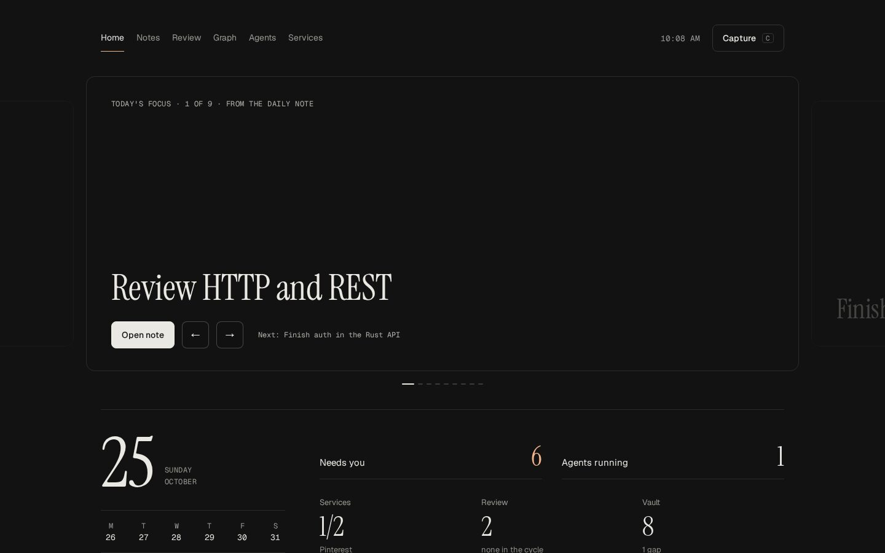

# Overlook

A local dashboard for an Obsidian vault: today's focus, spaced review, notes, graph, quick capture,
plus the coding agents (Claude Code, AGY) running on your machine. It reads your Markdown straight
from disk. No database, no build step, no cloud.


| Note reader | Alternate UI (`/grafite/`) |
| --- | --- |
|  |  |

## Quick start

Needs [Bun](https://bun.sh) (tested on 1.4).

```sh
git clone https://github.com/uKeps/overlook && cd overlook
cp .env.example .env
bun server.ts
```

Open http://127.0.0.1:3333. It starts on the bundled `example-vault/`, so you can look around first.
When you like it, point `VAULT_DIR` in `.env` at your own vault and restart.

Run it from the repo folder: Bun loads `.env` from the current directory.

## Your vault

Overlook expects this layout (the demo vault follows it). Folders outside it are ignored, and missing
ones just show up empty.

| Path | Used for |
| --- | --- |
| `1 Inbox/` … `8 …/` | Notes. Any folder starting with a digit 1–8 and a space (`7 …` is skipped: drawings) |
| `2 Daily/YYYY-MM-DD.md` | Daily note. `## Focus` feeds the Home carousel, captures land in `## Captured` |
| `2 Daily/_Template.md` | Optional template for new daily notes |
| `9 Agent/Log.md`, `Findings.md` | Optional agent log and gotchas (bullet lines) |

Frontmatter Overlook reads, all optional:

```yaml
type: concept         # concept, project and daily get special treatment; anything else is a label
area: programming     # colors the graph
tags: [web, api]
review_on: 2026-01-10 # shows up in Review on/after this date
interval: 2           # days; doubles when you remember, resets to 1 when you forget
```

Vault in Portuguese? Set `VAULT_LANG=pt` in `.env` and Overlook reads `2 Diário`, `## Foco de hoje`,
`## Capturei`, `9 Agente/Achados.md` and the `tipo` / `revisar_em` / `intervalo` keys instead.

A one-line summary comes from a `> [!abstract]` callout right after the title.

## Optional pieces

Everything below is off until you set it up. Skip what you don't need.

### Pinterest (card images)

Without Pinterest, cards use images from `ART_DIR` (default `~/Pictures/Wallpapers`), or none.

**Public board, no account setup:**

```sh
cp pinterest.example.json pinterest.json   # set "board": "your-user/your-board"
cp services.example.json services.json     # shows its status under Services
```

Restart. Images sync every 6 hours into `cache/`, or on demand from Services → *Sync now*.
This reads the public board page, not an official API, so it may break if Pinterest changes it.

**Private board (official API):** create an app at
[developers.pinterest.com](https://developers.pinterest.com/apps/) with redirect URI
`http://127.0.0.1:3333/auth/pinterest/callback` (with Tailscale installed it is
`https://<your-machine>.<tailnet>.ts.net/auth/pinterest/callback` instead), put its `PINTEREST_CLIENT_ID` and
`PINTEREST_CLIENT_SECRET` in `.env`, set `"board"` to the board name, restart and open
http://127.0.0.1:3333/auth/pinterest. Tokens are written back to `.env` and refreshed on their own.

### Services

`services.json` lists anything you run locally; Overlook pings each URL and can embed it.
See `services.example.json` for the fields.

### Agents

Running `claude`, `agy`, `codex` or `gemini` processes are detected automatically. Reading and
replying to a session needs the [Claude Code](https://claude.com/claude-code) or AGY CLI on your `PATH`.

### Phone access (Tailscale)

The server only listens on 127.0.0.1. With [Tailscale](https://tailscale.com) installed, it also
accepts requests addressed to your machine's tailnet name, so `tailscale serve --bg 3333` makes it
reachable from your phone over HTTPS.

### Image resizing

With ImageMagick (`magick`) installed, images are downscaled and cached; without it, originals are served.

## Run on login (Linux, systemd)

```ini
# ~/.config/systemd/user/overlook.service
[Service]
WorkingDirectory=%h/overlook
ExecStart=/usr/bin/bun server.ts
Restart=on-failure

[Install]
WantedBy=default.target
```

`systemctl --user enable --now overlook`

## For agents

`bun server.ts map` prints one line per note; `bun server.ts today` prints what the Home shows.

## License

MIT
