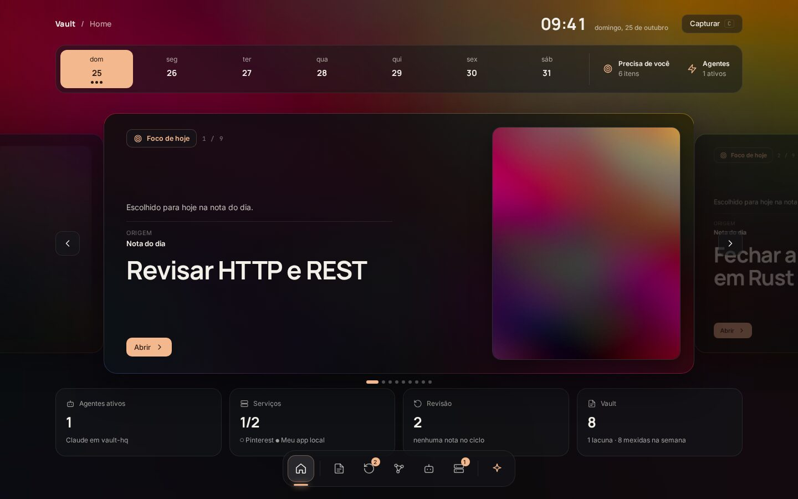
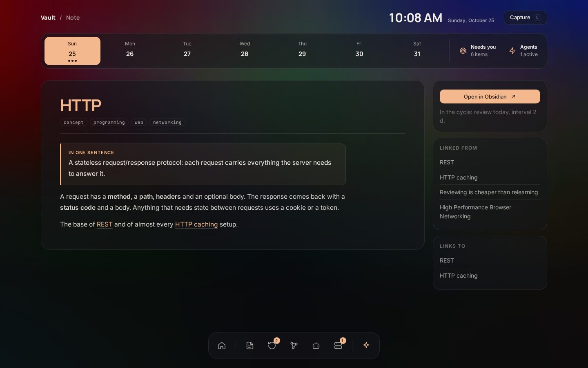
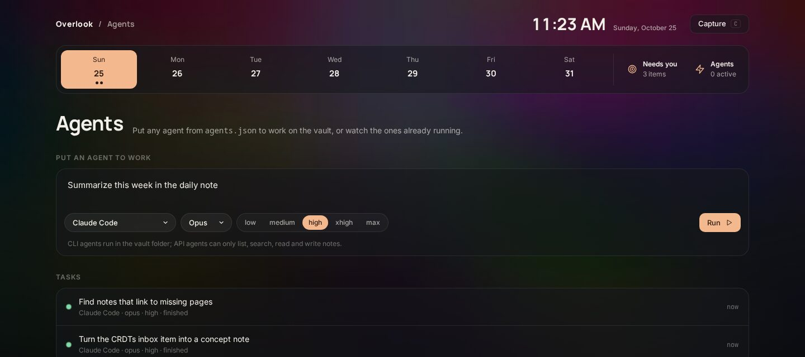
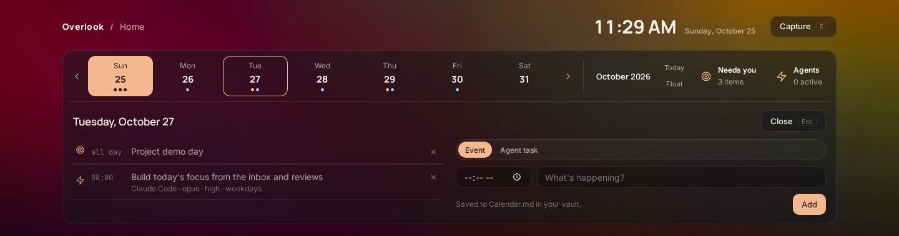

# Overlook

A local dashboard for an Obsidian vault: today's focus, spaced review, notes, graph, quick capture,
plus the coding agents (Claude Code, AGY) running on your machine. It reads your Markdown straight
from disk. No database, no build step, no cloud.



| Note reader | Agents |
| --- | --- |
|  |  |

## Quick start

Needs [Bun](https://bun.sh) (tested on 1.4).

```sh
git clone https://github.com/uKeps/overlook && cd overlook
cp .env.example .env
bun server.ts
```

Open http://127.0.0.1:3333. It starts on the bundled `example-vault/`, so you can look around first.
When you like it, point `VAULT_DIR` in `.env` at your own vault and restart.

Run it from the repo folder: Bun loads `.env` from the current directory.

## Your vault

Overlook expects this layout (the demo vault follows it). Folders outside it are ignored, and missing
ones just show up empty.

| Path | Used for |
| --- | --- |
| `1 Inbox/` … `8 …/` | Notes. Any folder starting with a digit 1–8 and a space (`7 …` is skipped: drawings) |
| `2 Daily/YYYY-MM-DD.md` | Daily note. `## Focus` feeds the Home carousel, captures land in `## Captured` |
| `2 Daily/_Template.md` | Optional template for new daily notes |
| `9 Agent/Log.md`, `Findings.md` | Optional agent log and gotchas (bullet lines) |

Frontmatter Overlook reads, all optional:

```yaml
type: concept         # concept, project and daily get special treatment; anything else is a label
area: programming     # colors the graph
tags: [web, api]
review_on: 2026-01-10 # shows up in Review on/after this date
interval: 2           # days; doubles when you remember, resets to 1 when you forget
```

Vault in Portuguese? Set `VAULT_LANG=pt` in `.env` and Overlook reads `2 Diário`, `## Foco de hoje`,
`## Capturei`, `9 Agente/Achados.md` and the `tipo` / `revisar_em` / `intervalo` keys instead.

A one-line summary comes from a `> [!abstract]` callout right after the title.

## Calendar

The strip under the top bar is a week (or month) calendar. Click a day to see what's on it and to add:

- **Events**, saved as plain lines in `Calendar.md` at the vault root (`- 2026-11-03 14:00 · Exam`, the time is
  optional), so they show up in Obsidian and agents can read them.
- **Agent tasks**: an agent, model, effort and prompt that run at a time, once or every day / weekday / week.
  They live in `schedule.json` next to Overlook and run while it is on; a run missed while it was off
  happens when it starts.

Reviews due and daily notes show up as dots too. *Float* folds the strip into a small pill at the top that
drops the calendar back in place on hover; *Pin* keeps it open.



## Optional pieces

Everything below is off until you set it up. Skip what you don't need.

### Pinterest (card images)

Without Pinterest, cards use images from `ART_DIR` (default `~/Pictures/Wallpapers`), or none.

**Public board, no account setup:**

```sh
cp pinterest.example.json pinterest.json   # set "board": "your-user/your-board"
cp services.example.json services.json     # shows its status under Services
```

Restart. Images sync every 6 hours into `cache/`, or on demand from Services → *Sync now*.
This reads the public board page, not an official API, so it may break if Pinterest changes it.

**Private board (official API):** create an app at
[developers.pinterest.com](https://developers.pinterest.com/apps/) with redirect URI
`http://127.0.0.1:3333/auth/pinterest/callback` (with Tailscale installed it is
`https://<your-machine>.<tailnet>.ts.net/auth/pinterest/callback` instead), put its `PINTEREST_CLIENT_ID` and
`PINTEREST_CLIENT_SECRET` in `.env`, set `"board"` to the board name, restart and open
http://127.0.0.1:3333/auth/pinterest. Tokens are written back to `.env` and refreshed on their own.

### Services

`services.json` lists anything you run locally; Overlook pings each URL and can embed it.
See `services.example.json` for the fields.

### Agents

The Agents page shows the agent processes running on your machine and lets you put one to work on the
vault: type a task, pick an agent, watch it run. Out of the box it knows `claude`, `agy`, `codex` and
`gemini`, and offers the ones on your `PATH`. Reading and replying to a running Claude Code or AGY session
works too.

To choose your own, `cp agents.example.json agents.json` and edit it. Two kinds of entry:

- **CLI agent**: `run` is the command, with `{prompt}` where the task goes. It runs in the vault folder
  with that CLI's own permissions (the example gives Claude Code `--permission-mode acceptEdits`).
  `process` is the name used to spot it running.
- **API agent**: `api` is `anthropic` or `openai` (any OpenAI-compatible endpoint: OpenAI, OpenRouter,
  Groq, a local Ollama), plus `model`, an optional `url`, and `key`, the name of the `.env` variable
  holding the API key. It gets four tools, `list_notes`, `search_notes`, `read_note` and `write_note`,
  limited to Markdown notes inside the vault. If the vault has an `AGENTS.md`, it becomes the agent's
  instructions. The Anthropic path needs `bun install` once, offers Opus 5.5, Sonnet 5.5 and Haiku 5.5
  at effort `high` by default, and turns on server-side refusal fallback.

Any entry can list `models` and `efforts` (plus a default `effort`). The task form then shows a model
and an effort picker for that agent: API agents send the choice to the provider, and CLI agents get it
through `{model}` and `{effort}` in `run`, e.g. `"--model", "{model}"`. Only listed values are accepted.
A model can be a plain id or `{"id": "gemini-4-argon", "label": "Gemini 4 Argon", "efforts": ["low", "high"]}`
when it needs a display name or its own effort levels (for a CLI that bakes the effort into the model id,
use `"--model", "{model}-{effort}"`).

**Open in…** Each entry can also list `open` commands, shown as buttons on a session's page and on a task's
page: `{session}` is the session id, `{cwd}` its folder, and a first token of `{terminal}` means your own
terminal (`xdg-terminal-exec`, or `$TERMINAL -e`). The built-in ones resume a Claude Code session with
`claude --resume`, an AGY conversation with `agy --conversation`, and open the folder in the Antigravity
app. Claude Code tasks get a fresh `--session-id`, so a finished task can be picked up in the terminal.
Any other app works the same way, as long as it can be launched with a command.

Tasks are kept in memory (the last 50) and can be stopped from their page.
The Morning and Inbox routines show up when the vault has an `AGENTS.md` with a Routines section.

### Phone access (Tailscale)

The server only listens on 127.0.0.1. With [Tailscale](https://tailscale.com) installed, it also
accepts requests addressed to your machine's tailnet name, so `tailscale serve --bg 3333` makes it
reachable from your phone over HTTPS.

### Image resizing

With ImageMagick (`magick`) installed, images are downscaled and cached; without it, originals are served.

## Run on login (Linux, systemd)

```ini
# ~/.config/systemd/user/overlook.service
[Service]
WorkingDirectory=%h/overlook
ExecStart=/usr/bin/bun server.ts
Restart=on-failure

[Install]
WantedBy=default.target
```

`systemctl --user enable --now overlook`

## For agents

`bun server.ts map` prints one line per note; `bun server.ts today` prints what the Home shows.

## Contributing

`main` only changes through pull requests. Branch, push, open a PR whose title is a
[Conventional Commit](https://www.conventionalcommits.org) (`feat: …`, `fix(review): …`), and it is
squash-merged once CI is green. CI scans the history for secrets and runs `bun test`, a smoke test
that boots the server on `example-vault/`, hits every endpoint and runs agents against fake providers;
run `bun install && bun test` locally before pushing.

## License

MIT
