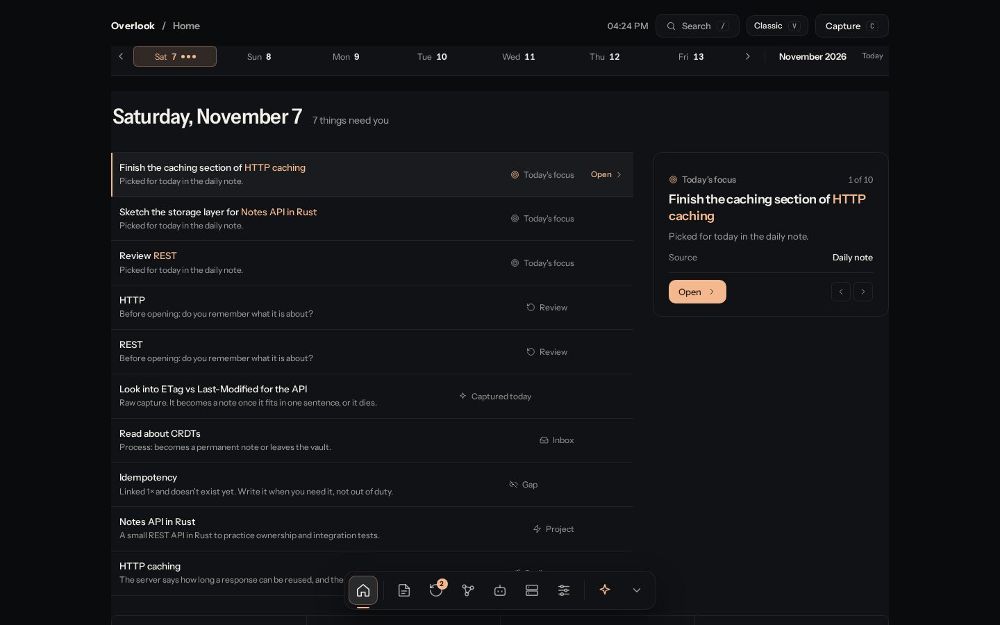
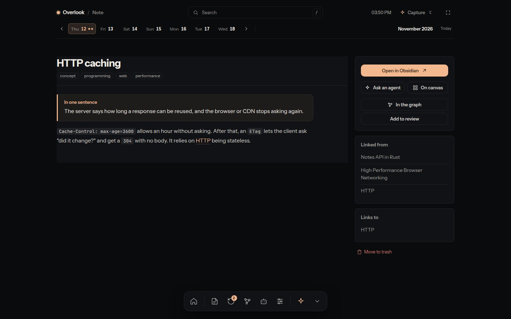
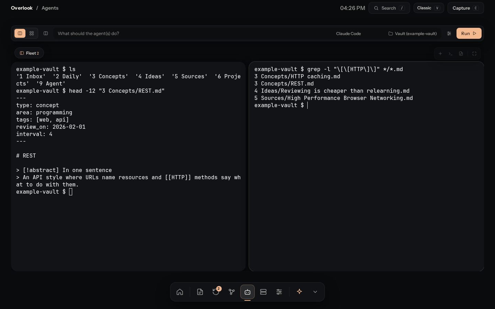

# Overlook

A local dashboard for an Obsidian vault, and a canvas for the coding agents you run on it. It reads your
Markdown straight from disk: no database, no build step, no cloud.



| Note reader | Agents canvas |
| --- | --- |
|  |  |

## Quick start

Needs [Bun](https://bun.sh) 1.4+.

```sh
git clone https://github.com/uKeps/overlook && cd overlook
cp .env.example .env
bun install
bun server.ts
```

Open http://127.0.0.1:3333. It starts on the bundled `example-vault/`. Point `VAULT_DIR` in `.env` at your own
vault (or set it in **Settings**) and restart. Run it from the repo folder: Bun reads `.env` from there.

## What's in it

- **Home**: in Minimal, a to-do list. Type a task in one line and its date, time, repeat and importance come out of
  the words ("pay the server on the 15th every month", "revisar PR amanhã 9h toda segunda", "!"); late ones roll into
  today, a repeating one comes back on its next date when done, and a click opens it to change any of that. One line
  below says when something needs you (an agent waiting, notes to review, the inbox). Tasks with a time notify you.
  Classic keeps the carousel: today's focus, reviews, the inbox, links to notes that don't exist yet.
- **Calendar** strip: events from `Calendar.md` (`- 2026-11-03 14:00 · Exam`) and agent tasks scheduled to run
  once or on a repeat.
- **Notes**, a reader with backlinks, a graph, full-text search (`/`) and quick capture (`C`) into the daily note.
- **Graph**: a map of the notes in columns by type (database → table → worker → platform → system → process → team),
  read from `type` in the frontmatter. Click a note to see what it links to (1–3 steps); "What depends on it" lights
  what may break if it changes and can hand that list to an agent. Vaults without those types get the force graph.
- **Review**: what you ask the vault comes back as a card in 1, 2, 4… days until you know it. Asking on Notes, the
  agent that answers adds the card to `Review.md`; "Save as a note" adds one for the new note. One card at a time
  waits on the Home; the page lists them all. Remove what is useless or out of date; known ones leave on their own.
- **Agents**: give a task to any CLI or API agent and watch it run. On the canvas, every card is a window: real
  terminals, agent TUIs (Claude Code, Antigravity), stickies and notes. Wire two terminal cards and the programs
  in them can talk with `overlook peers`, `overlook send <card> "…"` and `overlook read <card>`. Ctrl+Alt+/
  lists the shortcuts.
- Themes (Tokyo Night, Dracula, Catppuccin, Rosé Pine, Gruvbox, Nord) and two interfaces, Classic and Minimal (`V`).

## Your vault

The default layout, which the demo vault follows:

| Path | Used for |
| --- | --- |
| `1 Inbox/` … `8 …/` | Notes: folders starting with a digit 1–8 and a space (`7 …`, drawings, is skipped) |
| `*.md` at the root | Notes too, except `AGENTS.md`, `CLAUDE.md`, `GEMINI.md`, `README.md`, `Calendar.md`, `Tasks.md` and `Review.md` |
| `Tasks.md` | The to-do list, in the Obsidian Tasks format (`- [ ] what 🔁 every week 📅 2026-11-12`): edit it there too |
| `Review.md` | The review cards, one line each: `- question :: answer [[note]]`; Overlook adds the schedule in a comment |
| `2 Daily/YYYY-MM-DD.md` | Daily note: `## Focus` feeds the Home, captures land in `## Captured` |
| `9 Agent/Log.md`, `Findings.md` | Optional agent log and gotchas |
| `AGENTS.md` | Optional instructions for agents; with it, the Morning and Inbox routines show up |

Frontmatter, all optional: `type` (concept, project, daily), `area`, `tags`, `confidence`, `updated`
(a note still carrying the older `review_on` / `interval` shows up as a review card). A `> [!abstract]` callout right after the title is the note's summary.
`VAULT_LANG=pt` reads the Portuguese names instead (`2 Diário`, `## Foco de hoje`, `Tarefas.md`, `Revisão.md`…).

Laid out another way? A `vault.json` next to `agents.json` renames what you need. Every key is optional:

```json
{
  "folders": ["Inbox", "Notes", "Projects", "Journal"],
  "inbox": "Inbox",
  "daily": "Journal",
  "focus": "Today",
  "captured": "Captured",
  "keys": { "type": "kind" }
}
```

Also `log`, `findings`, `calendar` and `types`. Save Settings or restart after editing it.

## Configuration

Everything is optional, and **Settings** edits most of it. Personal files stay out of git.

| File | What it holds | Start from |
| --- | --- | --- |
| `.env` | Vault path and language, port, API keys, `TRANSCRIBE` | `.env.example` |
| `agents.json` | The agents you can run (default: `claude`, `agy`, `codex`, `gemini` when on the `PATH`) | `agents.example.json` |
| `vault.json` | Your vault's layout (above) | — |
| `services.json` | Local apps to ping and embed | `services.example.json` |
| `pinterest.json` | Card image choices and the Pinterest board | `pinterest.example.json` |
| `schedule.json` | Scheduled agent tasks (written by the calendar) | — |

### Agents

Each `agents.json` entry is one of two kinds:

- **CLI**: `run` is the command, with `{prompt}` where the task goes (plus `{model}`, `{effort}`, `{session}`).
  It runs in the vault with that CLI's own permissions. Optional: `process` (to spot it running), `tui` (opens
  it on the canvas; `{log}` there names a log file the conversation id is read from, for CLIs like agy that
  can't take a session id up front), `open` (buttons that resume a session elsewhere), `canvas` (args that tell it about wires).
- **API**: `api` is `anthropic` or `openai` (any OpenAI-compatible endpoint: OpenRouter, Groq, Ollama), with
  `model`, an optional `url`, and `key`, the `.env` variable holding the key. It gets four tools limited to the
  vault's notes (`list_notes`, `search_notes`, `read_note`, `write_note`), and `AGENTS.md` as instructions.

Any entry can list `models` and `efforts`; the task form then offers them. A request that names no agent goes to
the first one in the file that can run here. `agents.example.json` has one of each.

### Optional pieces

- **Card images**: a folder of your photos or a public Pinterest board (`user/board`), set in Services →
  *Manage images*. With neither, the cards show animated ascii scenes from [ascii.rest](https://ascii.rest).
  A private board needs a [Pinterest app](https://developers.pinterest.com/apps/) with redirect URI
  `http://127.0.0.1:3333/auth/pinterest/callback`: put its `PINTEREST_CLIENT_ID` / `PINTEREST_CLIENT_SECRET` in
  `.env` and open `/auth/pinterest`.
- **Voice memos**: set `TRANSCRIBE` to a command that reads audio on stdin and prints the text (e.g. a whisper
  script). `POST /api/voice` with `{"audio": "<base64>", "name": "Walk.m4a"}` turns the recording into an inbox
  note and hands it to an agent to file. A failure lands in today's note.
- **Phone access**: the server only listens on 127.0.0.1, but accepts your Tailscale machine name, so
  `tailscale serve --bg 3333` opens it to your devices over HTTPS.
- **ImageMagick** (`magick`) downscales and caches images; without it, originals are served.

## Run on login (Linux, systemd)

```ini
# ~/.config/systemd/user/overlook.service
[Service]
WorkingDirectory=%h/overlook
ExecStart=/usr/bin/bun server.ts
Restart=on-failure

[Install]
WantedBy=default.target
```

`systemctl --user enable --now overlook`

## For agents

`bun server.ts map` prints one line per note; `bun server.ts today` prints what the Home shows, today's tasks included.
`bin/overlook todo "…"` adds a to-do from any terminal (`overlook todo` alone lists today's).

## Contributing

`main` changes through pull requests whose title is a [Conventional Commit](https://www.conventionalcommits.org)
(`feat: …`, `fix(review): …`), squash-merged once CI is green. CI scans the history for secrets and runs
`bun test`, which boots the server on `example-vault/` and runs agents against fake providers. Run
`bun install && bun test` before pushing.

## License

MIT
